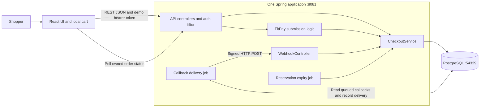
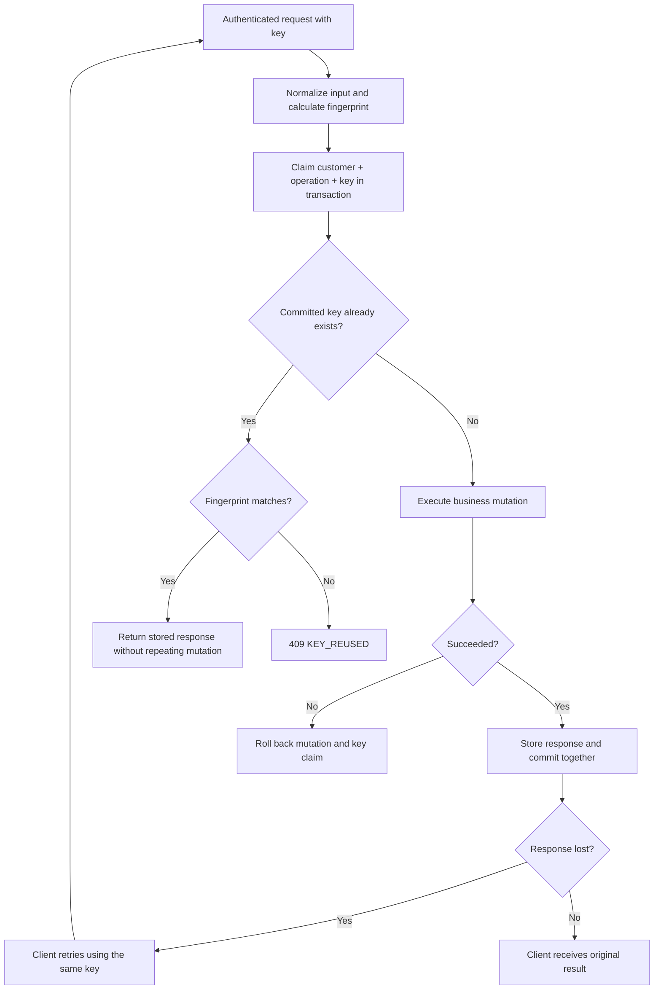
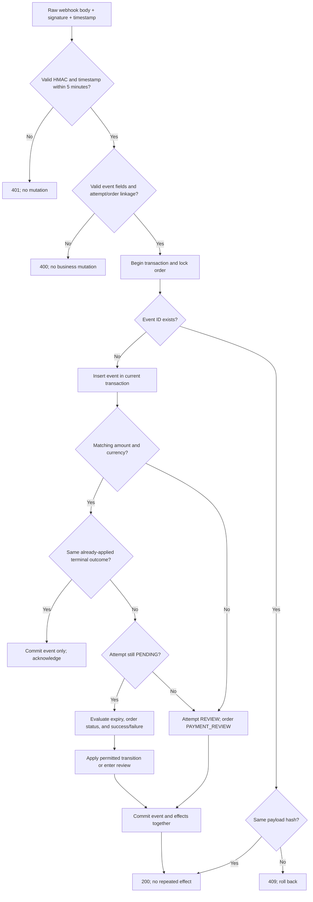
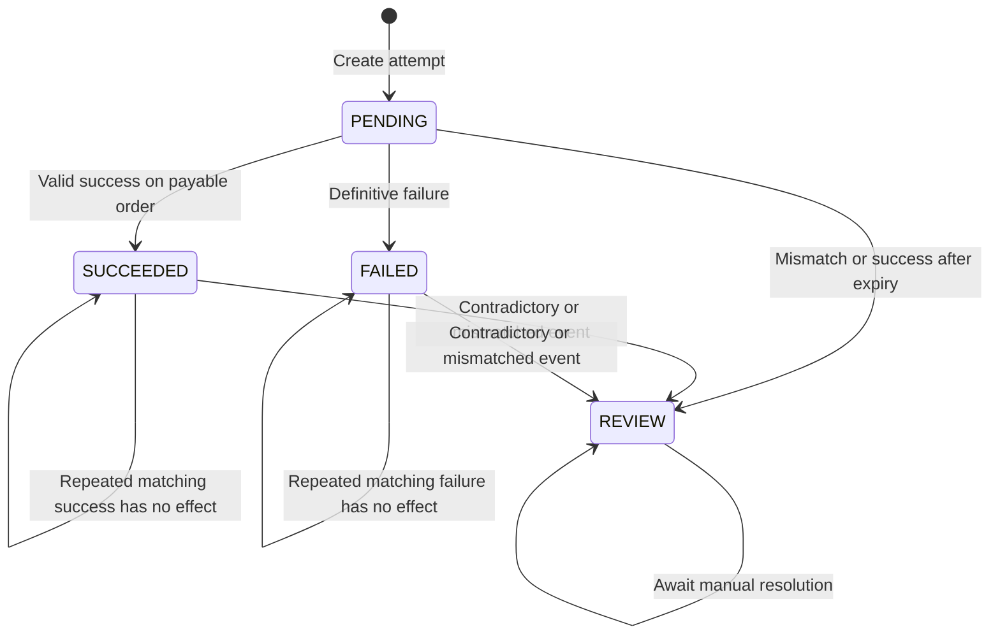
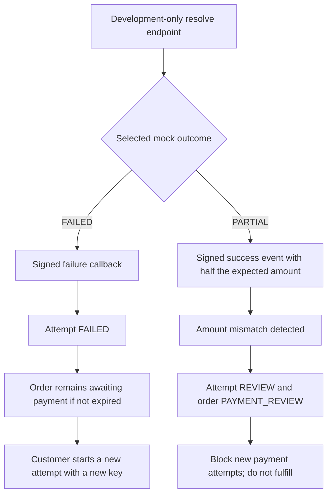
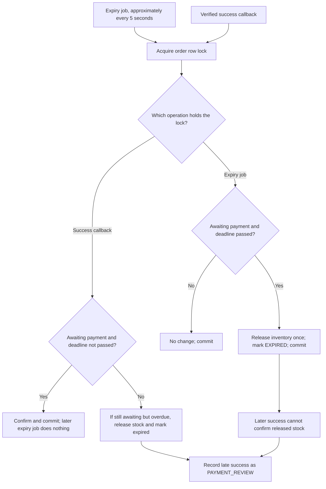
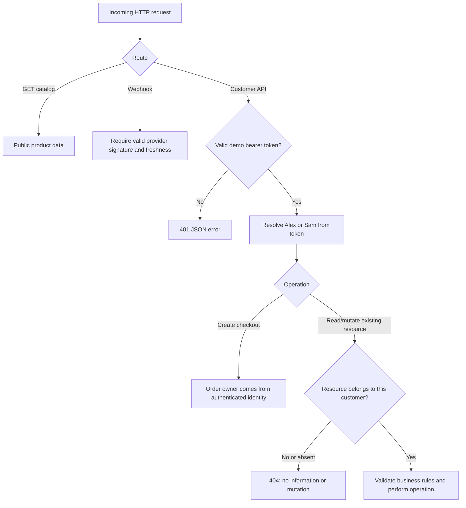
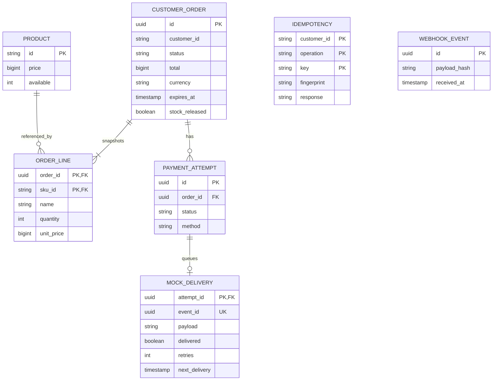

# Checkout design diagrams

These diagrams describe the current implementation. Read them in order: architecture → checkout → payment → failure recovery. Boxes inside Spring are logical components in one process, not microservices. Arrows in sequence diagrams run from top to bottom. A database transaction commits all its writes together or rolls them back.

## 1. System architecture



The frontend runs on port 5173 and proxies `/api` requests to Spring. FitPay is a simulated provider: it sends real HTTP callbacks to our own webhook, but does not contact a bank. PostgreSQL owns prices, inventory, orders, payment attempts, retry records, and queued callbacks.

**Interview point:** A provider boundary is useful even in a mock because the customer response and payment confirmation are separate events.

## 2. Catalog, cart, and checkout

```mermaid
sequenceDiagram
    actor U as Shopper
    participant B as Browser
    participant A as Spring API
    participant D as PostgreSQL
    B->>A: GET /api/products
    A->>D: Read prices and available stock
    A-->>B: Product DTOs
    U->>B: Add items or change quantities
    B->>B: Update localStorage cart and sticky bag summary
    Note over B,D: Adding to cart does not reserve inventory
    U->>B: Continue to checkout
    B->>B: Reuse or generate key for this checkout request
    B->>A: POST /api/orders with SKU IDs, quantities, key, token
    A->>A: Authenticate and validate; normalize duplicate SKUs
    A->>D: BEGIN; claim idempotency key
    loop Each SKU in sorted order
        A->>D: Decrement stock only if enough remains
        A->>D: Read server price and snapshot order line
    end
    alt Any item cannot be reserved
        A->>D: ROLLBACK all stock changes and key claim
        A-->>B: 409 OUT_OF_STOCK
    else All items reserved
        A->>D: Create AWAITING_PAYMENT order; expires in 15 minutes
        A->>D: Store original response; COMMIT
        A-->>B: 201 Order and Location
        B->>B: Clear acknowledged cart and show order page
    end
```

The client never supplies trusted prices. The 15-minute reservation survives after the transaction ends; database locks do not remain open during payment.

## 3. Two shoppers race for the last unit

```mermaid
sequenceDiagram
    participant A as Customer A transaction
    participant D as Product row: available = 1
    participant B as Customer B transaction
    A->>D: UPDATE available = available - 1 WHERE available >= 1
    D-->>A: One row updated; row lock held
    B->>D: Same conditional UPDATE
    Note over B,D: B waits for A's transaction
    A->>D: Create order and COMMIT
    D-->>B: Recheck condition against available = 0
    D-->>B: Zero rows updated
    B->>B: Roll back checkout; return 409
```

If A rolls back instead, B may succeed. For a multi-item cart, failure on any item rolls back every earlier decrement. Sorted SKU access reduces deadlocks; retryable database contention returns 503.

**Code/test:** `CheckoutService.checkout`; `lastUnitHasOneWinner`, `multiItemFailureRollsBackStockAndIdempotency`.

## 4. Double-submit and lost-response retries



A concurrent insert for the same key waits for the first transaction. It then sees the committed response, or can claim the key after rollback. The replay is the original creation response, not a current order-status read. Keys are scoped to customer and operation. A different key represents a new operation.

**Code/test:** `CheckoutService.idempotent`; concurrent checkout/attempt tests. A separate live check confirmed the same checkout response after a process restart.

## 5. Payment method to webhook-confirmed order

```mermaid
sequenceDiagram
    actor U as Shopper
    participant B as Browser / FitPay screen
    participant A as Spring API
    participant D as PostgreSQL
    participant W as Callback job
    participant H as Webhook endpoint
    U->>B: Continue to payment
    B->>A: POST /orders/{id}/payment-attempts + key
    A->>D: Lock owned order; validate state and expiry
    A->>D: Create PENDING attempt and replay response atomically
    A-->>B: 201 attempt
    U->>B: Choose demo UPI / card / netbanking; Pay
    B->>A: POST /payments/{attemptId}/pay with method
    A->>D: Lock owned order; fix outcome; save method and callback
    A-->>B: 202 PROCESSING
    Note over A,D: Order is still AWAITING_PAYMENT
    W->>D: Read undelivered callback after commit
    W->>W: Sign timestamp and exact payload with HMAC
    W->>H: POST /webhooks/payment
    H->>H: Authenticate signature and freshness; parse event
    H->>D: Lock order; deduplicate; validate amount and lifecycle
    H->>D: Commit event + SUCCEEDED attempt + CONFIRMED order
    H-->>W: 200 received
    W->>D: Mark callback delivered
    B->>A: GET /orders/{id}
    A-->>B: CONFIRMED
    B-->>U: Payment confirmed
```

The callback job checks approximately every second, after the previous run completes. Browser polling runs every three seconds while the order awaits payment. Pay creates one fixed outcome per attempt; resubmitting cannot create another payment effect. No real payment credentials are collected.

## 6. Webhook validation and duplicate handling



Signature authentication happens before parsing or deduplication. Exact duplicate payloads are harmless within the freshness window. A legitimate retry after that window uses the same event ID and body with a fresh delivery timestamp/signature. A different event ID describing the same terminal success is also guarded by the attempt state.

If processing rolls back, event consumption rolls back too: the provider can retry. This gives idempotent business effects, not exactly-once network delivery.

## 7. Delivery timeout and provider retry

```mermaid
sequenceDiagram
    participant W as Callback job
    participant H as Webhook handler
    participant D as PostgreSQL
    W->>H: Signed callback
    H->>D: Commit confirmation and event ID
    H--xW: Response lost or request times out
    W->>D: Increment retries; schedule next attempt in 5 seconds
    W->>H: Same event/body; fresh delivery timestamp and signature
    H->>D: Find already committed event with same hash
    H-->>W: 200; no repeated effect
    W->>D: Mark delivered
```

A non-2xx response also schedules retry. The queue is durable, but the current implementation has no retry ceiling or alert. Callback delivery across an actual process restart has not yet been explicitly verified; checkout idempotency across restart has.

## 8. Order and payment-attempt lifecycles

```mermaid
stateDiagram-v2
    state "Order" as Order {
        [*] --> AWAITING_PAYMENT: Checkout commits reservation
        AWAITING_PAYMENT --> AWAITING_PAYMENT: Definitive payment failure; retry remains possible
        AWAITING_PAYMENT --> CONFIRMED: Exact successful payment before expiry
        AWAITING_PAYMENT --> EXPIRED: Deadline passed; release stock once
        AWAITING_PAYMENT --> PAYMENT_REVIEW: Amount mismatch or contradictory event
        EXPIRED --> PAYMENT_REVIEW: Late successful payment
        CONFIRMED --> PAYMENT_REVIEW: Contradictory or mismatched new event
    }
```





**Important distinctions:**

- Retrying a failed payment creates a **new** PENDING attempt; it does not reset the old FAILED row.
- Timeout is not failure. An unknown outcome stays pending and does not permit another attempt.
- Expiry changes the order and inventory, not automatically the attempt status.
- A repeated old failure does not undo a later success. A genuinely contradictory event can move even a confirmed order into review.
- An operator can resolve PAYMENT_REVIEW to CANCELLED through an audited mock refund/cancellation. Reserved stock is released once; late callbacks cannot resurrect the order. Real provider reconciliation remains out of scope.

## 9. Failed and partial payments



Failure controls are absent from FitPay's shopper UI. Use the API example in [API.md](API.md) with a fresh pending attempt before clicking Pay. The mock outcome becomes immutable after submission. Partial-payment handling is detection and containment, not automated refund support.

## 10. Reservation expiry versus success



The success callback checks the deadline itself. It cannot bypass expiry just because the scheduled job has not run yet. A `stock_released` guard prevents duplicate release. `expires_at` remains on confirmed orders as historical data; it does not make confirmed orders expire later.

## 11. Authentication and ownership



The browser never supplies a trusted customer ID. Payment endpoints resolve the attempt's order and check that order's owner before changing outcome, method, or delivery metadata. Tests exercise both Alex → Sam and Sam → Alex, including replay attempts and unchanged database snapshots. The two public demo tokens are an assignment convenience, not production login security.

## 12. Data model



Idempotency and webhook-event records are intentionally shown without invented foreign-key relationships: the schema does not declare them. The queued callback carries attempt/order IDs in its JSON payload. A partial unique index permits at most one PENDING attempt per order.

## Reading the code alongside the diagrams

| Diagrams | Implementation | Useful test |
| --- | --- | --- |
| 2–4 | `CheckoutService.checkout`, `idempotent` | `lastUnitHasOneWinner`, `concurrentCheckoutReplaysSameResponseAndRejectsChangedInput` |
| 5–7 | `pay`, `simulate`, `receive`, `WebhookController`, `BackgroundJobs` | `customerPaymentQueuesOneCallbackAndDoesNotConfirmDirectly`, `rawBodySignatureAndFreshnessAreVerifiedBeforeMutation` |
| 8–10 | `attempt`, `receive`, `expire`, `release` | `failedAttemptCanRetryAndOldFailureDoesNotRegressConfirmation`, `expiryAndSuccessRaceCannotConfirmReleasedStock` |
| 11 | `DemoAuth`, `owned` | `anotherCustomerCannotPayOrReplayPayment` |
| 12 | Flyway migrations V1 and V2 | PostgreSQL constraints exercised by integration tests |

The most useful interview walkthrough is diagrams **2 → 3 → 4 → 5 → 10**: start with the happy path, explain concurrency, explain a lost response, then show why payment confirmation and inventory expiry need explicit coordination.

Operator recovery adds `PAYMENT_REVIEW → CANCELLED`. Callback delivery stops after five failures with exponential backoff and becomes EXHAUSTED until an operator requeues the original event.
